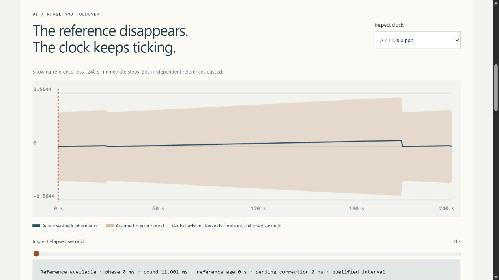

# Mission Clock Integrity Lab

The [qualified timestamp partial-order review](docs/ORDER_REVIEW.md) now exposes minimal guaranteed-order edges, readiness frontiers and per-event unordered relationships. Unqualified evidence and touching intervals never become an invented total order; timestamp order is not causality.

**Same event. Different clocks.** CHRONICLE is an offline synthetic timing instrument by [Jason Stys](https://github.com/JasonStys). Explore clock drift, reference blackouts, path asymmetry, phase steps, rate-limited corrections and ambiguous telemetry order—without changing your computer clock or contacting a timing server.

**C++20** evolves bounded integer-nanosecond clock states. A dependency-free **Rust** worker audits closed timestamp intervals and source sequences. Independent **Python** implementations must agree exactly with both workers before results are released. **TypeScript/HTML/CSS/Canvas** provide the accessible browser instrument; optional **SQL/SQLite** retains immutable local evidence.



## Features

- Six fictional cases: stable reference, blackout, asymmetric paths, backward clock step, out-of-envelope oscillator and reordered telemetry.
- Compare immediate phase steps with capped slewing. Inspect actual phase, assumed error envelope, reference age, pending correction, mode and qualification at every one-second tick.
- Distinguish reference loss from expired holdover and invalid bounds. **Known simulation truth** flags envelope violations; this is not a claim that real clocks can detect their own true error.
- Classify event pairs as strictly before, strictly after, ambiguous or unqualified. **Touching is not strictly ordered; time order is not causality.** Arrival order and source-sequence regressions remain separate.
- Export complete JSON, all sample rows as dimensioned CSV, escaped script-free HTML, and an editable strict input profile. Keep the exact report SHA-256 and model assumptions with the evidence.
- Test all **216 finite UI combinations**, hand-derived drift and interval boundaries, generated models, hostile native-parser inputs and three real browser engines.

## Download and run

[Download a portable release](https://github.com/JasonStys/mission-clock-integrity-lab/releases/latest) for Windows x64, Linux x64 or macOS Apple Silicon and its matching `.sha256`. Verify the digest, then extract the **entire** `MissionClockIntegrityLab` directory. Open `MissionClockIntegrityLab.exe` on Windows or run `./MissionClockIntegrityLab` on Linux/macOS; ZIP extraction may require restoring executable permission there.

The app opens your normal browser on an ephemeral **127.0.0.1** port. Keep its console open; Ctrl+C stops it. No account, Python/Node/compiler installation, internet connection, administrator access or Docker is required for a portable bundle. These are **unsigned/unnotarized desktop applications**, not mobile installers or a public hosted service. Respect OS policy; do not bypass warnings.

## Source quick start

Requires Python **3.12–3.14**, Node **24**, a C++20 compiler/CMake, and the pinned Rust **1.98.1** toolchain with clippy/rustfmt. Windows needs Visual Studio 2022/2026 C++ tools; Linux/macOS use their installed compiler. Only development/build dependencies are installed: the Python and Rust runtimes have no third-party package/crate dependencies.

```powershell
python -m venv .venv
.venv/Scripts/python -m pip install --require-hashes -r requirements-dev.lock
.venv/Scripts/python tools/build_native.py
.venv/Scripts/python tools/build_rust.py
npm ci
npm run build
.venv/Scripts/python -m clocklab serve
```

Use `.venv/bin/python` on Linux/macOS. Restricted development environments may need task-owned TEMP/TMP paths and ordinary permission to invoke their installed compiler; do not disable host protections.

## CLI evidence and custom scenarios

```powershell
.venv/Scripts/python -m clocklab export --scenario clock-step --output step.json
.venv/Scripts/python -m clocklab export --scenario clock-step --policy 1 --format csv --output slew.csv
.venv/Scripts/python -m clocklab export --input examples/blackout.json --format html --output blackout.html --history private.sqlite3
```

Exports refuse to overwrite existing files. Custom profiles are deliberately bounded, local JSON—not scripts, clock-control instructions, remote URLs or browser uploads. [API/input documentation](docs/API.md) defines every field and protocol. SQLite history is **unencrypted**, optional, hash-verified and capped at 100 distinct reports with no automatic pruning. It is not protected from an OS user with file access. Keep your histories/exports outside Git.

## Verification commands

```powershell
.venv/Scripts/python -m ruff check clocklab tests tools launcher.py
.venv/Scripts/python -m ruff format --check clocklab tests tools launcher.py
.venv/Scripts/python -m mypy clocklab
.venv/Scripts/python tools/verify_repo.py
.venv/Scripts/python -m pytest --cov=clocklab --cov-report=term-missing
.venv/Scripts/python -m tools.benchmark
npm run format:check
npm test
npm run build
npx playwright install chromium firefox webkit
npm run test:e2e
.venv/Scripts/python tools/package_app.py
```

CI additionally runs actual Clang **ASan/UBSan** requests, GCC native line coverage, Rust tests/clippy and CodeQL for C++, Python and TypeScript. The [validation report](docs/VALIDATION.md) distinguishes executed evidence from workflow definitions. No Actions artifacts or caches are uploaded. Release ZIP/checksum pairs go directly to an exact-commit-gated draft, then are downloaded and verified before publication. No old runs or account data are deleted automatically.

## File and feature map

| Path                                                  | Purpose                                                                                  |
| ----------------------------------------------------- | ---------------------------------------------------------------------------------------- |
| `native/core.hpp`, `core.cpp`, `cli.cpp`, `tests.cpp` | Bounded integer clock model, strict numeric protocol and analytical C++ contracts        |
| `auditor/src/main.rs`                                 | Safe closed-interval audit, source/arrival disorder checks and Rust tests                |
| `clocklab/model.py`                                   | Strict profile validation, finite presets and wire serialization                         |
| `clocklab/reference.py`                               | Independently structured Python clock and interval implementations                       |
| `clocklab/engine.py`                                  | Fixed native process orchestration, exact agreement/accounting gates and report identity |
| `clocklab/reports.py`, `resources/history.sql`        | Full exports and optional immutable, idempotent local history                            |
| `clocklab/server.py`, `__main__.py`, `launcher.py`    | Protected read-only loopback server, explicit CLI and portable launcher                  |
| `web/`                                                | Defensive typed UI, real evidence plots, inspector and pair interpretation               |
| `tests/`                                              | Finite-space/property/analytical/schema/native-parser/HTTP/SQL/CLI/browser regressions   |
| `tools/`                                              | Native builds, benchmarks, sanitizer requests, exact-line inventory and release gates    |
| `examples/`, `docs/`, `licenses/`                     | Editable profile, model/user/API/validation guides and runtime notices                   |
| `.github/workflows/`                                  | Pinned least-privilege Validation, CodeQL and manual draft-release pipelines             |

Every code file has a creator/responsibility header; major functions/classes describe their contracts. Generated [CODE_INDEX](docs/CODE_INDEX.md) records definition/variable line locations; [FILE_CATALOG](docs/FILE_CATALOG.md) summarizes every tracked-intent file. CI rejects stale inventories, avoiding manually duplicated line numbers that drift after edits.

## Limits, documentation and contact

This is **synthetic civilian timing education**, not an NTP/PTP implementation, calibrated oscillator model, authenticated time service, UTC certificate or flight-qualified system. No leap-second/time-scale conversion, stochastic clock noise, relativity, real GNSS, hardware interface, host-time adjustment, automatic operational decision or causal-order inference is implemented.

[Model/research](docs/MODEL.md) · [Architecture](docs/ARCHITECTURE.md) · [User guide](docs/USER_GUIDE.md) · [Input/API](docs/API.md) · [Validation](docs/VALIDATION.md) · [Release/runbook](docs/RELEASE.md) · [Security](SECURITY.md) · [Notices](docs/THIRD_PARTY.md).

Created by **Jason Stys**. [Portfolio/contact](https://github.com/JasonStys) · [Help/issues](https://github.com/JasonStys/mission-clock-integrity-lab/issues). MIT project source; runtime notices retain their own terms. No agency, employer or mission endorsement. Contributions should include a small synthetic reproduction, independent expected answer, regression and updated documentation—not refreshed baselines to silence failures.
